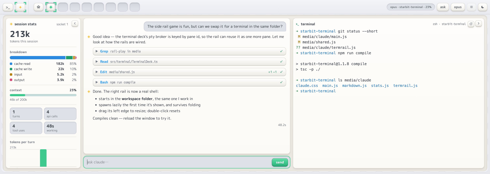
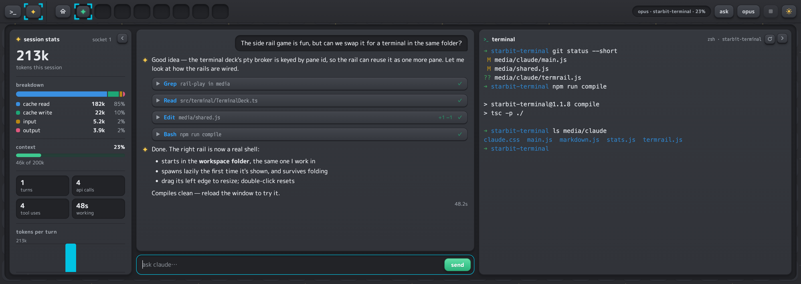
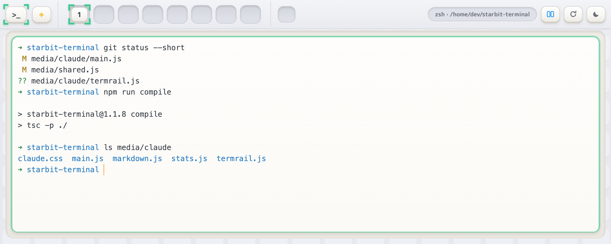

# StarBitTerminal

A cozy, Nintendo-inspired terminal panel for VS Code — quilted wallpaper,
puffy key tiles, a mint corner-bracket cursor on the active tab, and warm
cream terminal cards on a greige tray. Lives in the bottom panel next to your
regular Terminal tab, with a `>_` / ✦ switch between terminals and a Claude
Code chat built on the Claude Agent SDK.



<details>
<summary>Dark theme and the terminal deck</summary>





</details>

**How it's built:** a VS Code webview view, plain TypeScript on the extension
side and dependency-free JavaScript/CSS in the webview (no framework, no
bundler, strict CSP). The extension host is a thin broker: `node-pty` shells
for the terminals and the Claude Agent SDK for chat sessions. All UI state
lives in the webview, and both decks share one message channel.

Every pane is a real terminal (xterm.js + node-pty), so Claude Code and
everything else behaves exactly as it does anywhere — arrow-key menus,
Ctrl+C, paste, all of it.

- **Slots**: a fixed row of 8 sockets, like the HOME menu. Click any empty
  socket to open a terminal there; each terminal is a puffy tile in its slot.
- **Splits**: the split key adds a side-by-side pane (up to 3 per tab).
- **Command bits**: the small sockets after the terminal slots hold up to
  six coloured ✦ keys, each with a saved command. Click one to run it in
  the focused terminal (a dead shell is restarted first), or drag it onto
  a pane to run it there. The `+` socket adds one; the `⋯` dot or a
  right-click edits or removes it. Saved in `starbit.commandBits`.
- **Path plate**: the `zsh · /folder` plate on the right of the bar is the
  focused pane's working directory, and it is editable. Click it (or focus
  it and press Enter) and type where you want to go — `~`, a path relative
  to the current folder, or an absolute one. Enter checks the folder exists
  and types the `cd` into that pane's shell; Esc cancels. A folder that
  isn't there leaves the field open, outlined in red. If the shell has
  exited it is restarted first.
- **Restart key**: kills and respawns the focused pane's shell.
- Hover a tab or pane for its close button.

## Prerequisites

- VS Code 1.90+
- Node.js 18+
- Claude Code installed and working (`claude` runs in a normal terminal)

## Setup

```bash
npm install
```

Then rebuild node-pty against VS Code's Electron (one-time step, repeat after
major VS Code updates):

1. In VS Code: **Help → About** and note the **Electron** version (e.g. `30.4.0`).
2. Run:

```bash
npx @electron/rebuild -v <electron-version> -f -w node-pty
```

## Run it

Open this folder in VS Code and press **F5**. In the Extension Development
Host window, open the panel (**View → Appearance → Panel** if hidden) and
click the **StarBit** tab. The `>_` / ✦ switch at the left of the bar flips
between the terminals and Claude — or run **StarBit: Open Terminal Panel** /
**StarBit: Open Claude Panel** from the command palette.

Drag the StarBitTerminal tab out of the panel to float it as its own window, or dock
it wherever you like — it's a normal VS Code view.

## Install it permanently

```bash
npm install -g @vscode/vsce
vsce package
```

Then in VS Code: **Extensions → ⋯ → Install from VSIX** and pick the
generated `.vsix`.

## Make Claude Code match the vibe

If you run the `claude` TUI inside a terminal pane, use `/theme` to match
it to the panel: a **light** theme on Basic White, a **dark** one on Basic
Black.

## The Claude panel

The ✦ deck (the switch at the left of the bar) is built on the Claude Agent SDK. It is
the same Claude Code that runs in your terminal (same CLAUDE.md, settings,
hooks, skills, MCP servers, same login), but its prompts are real StarBit
keys instead of TUI menus:

- **Sockets are sessions.** Up to 8 side-by-side Claude sessions, one tile
  each. The tile's face is a status star bit: mint and still when Claude
  is ready or done, gold and spinning while it works, red and pulsing
  when it is waiting on you (a permission, a question, a plan), grey once
  the session has ended. A blue dot marks a session that finished a turn
  in the background. The panel tab itself shows a count while any prompt
  is waiting.
- **Permission prompts** appear as a recessed card with `allow`,
  `allow for session`, `always allow` and `deny` keys (deny lets you tell
  Claude why). Edits show the diff you are approving; Bash shows the
  command.
- **Questions** (`AskUserQuestion`) render as option tiles; **plan
  approval** offers `approve & build`, `approve, ask before edits` and
  `keep planning`. Arrow keys move the bracket cursor, Enter picks, Esc
  declines.
- **Tool calls** are compact chips (`Read`, `Edit +12 −2`, `Bash …`); click
  to expand the input and result, click a path to open it.
- **Toolbar**: the mode key cycles `ask → edits → plan`, the model key
  picks a model, the square stops the current turn. Type `/` in the
  composer for slash commands (`/compact`, `/clear`, your skills…):
  Enter runs the highlighted command (or completes it if it takes
  arguments), Tab only completes. A bare `/model` opens the model picker.
- **Events** in the transcript are pills, not bubbles: `resumed`,
  `interrupted`, errors. Compaction shows as a card with the token
  before/after count (click it to read the summary); a model switch shows
  the old and new model tiles with star bits hopping between them.
- The status plate shows `model · folder · context%` and turns amber past
  70% and red past 90%.
- **Side rails** beside the transcript, as their own cards that stay put
  while the transcript streams or scrolls. Each one has a small chevron key
  at its top-right that folds it into a slim strip (click the strip to bring
  it back); the two fold independently.
  - *Terminal* (right, whenever the tray has room for it beside a readable
    transcript — about 830px+): a real shell in the workspace folder, the
    same folder Claude works in, so you can watch the chat and run commands
    on one screen. It always opens folded to a strip; click the strip and
    the shell starts, then keeps running while it is folded again, the panel
    narrows or the `>_` deck is in front. Drag its left edge to resize it (double-click the edge to reset);
    ↻ in its header restarts the shell. Links, file paths and file drops
    work as in the terminal deck.
  - *Session stats* (left, when the panel is wide — e.g. maximized,
    1180px+ of tray — and there is room left beside the terminal; for the
    socket in front; its fold is remembered): total tokens, a cache read / cache write / input /
    output breakdown, the context meter, turns, API calls, tool uses and
    time working, a tokens-per-turn column chart (hover a column for its
    numbers), the top tools, and a per-model split when more than one model
    ran. Counted from the SDK's `modelUsage` since the socket started (a
    resumed chat counts from the resume); a live pill ticks up while a turn
    runs. Costs are deliberately not shown.

No auth code lives in this extension: it never reads, stores or asks for
credentials. The panel launches the `claude` binary your login shell finds
(or `starbit.claudePath`) and uses whatever that install is signed in to
(or `ANTHROPIC_API_KEY` from your environment). You are responsible for
using it in line with the terms for that account. Run **StarBit: Check
Claude Code Connection** from the command palette to verify the binary,
version and account.

Keep the Agent SDK in `package.json` at the same version as your installed
Claude Code (`claude --version`). After `claude update`, run
`npm i @anthropic-ai/claude-agent-sdk@<that version> --save-exact`,
rebuild and reinstall the VSIX.

## Themes

Two Nintendo-flavored themes, toggled with the sun/moon key (your choice is
saved to settings):

- **Basic White** — 3DS HOME menu: quilted wallpaper, greige tray, cream
  panes, mint bracket cursor.
- **Basic Black** — Switch: charcoal everything, quiet chrome, vivid cyan
  selection.

Or set `starbit.theme` to `light` / `dark` directly.

## Settings

| Setting | Default | What it does |
| --- | --- | --- |
| `starbit.autoCommand` | *(empty)* | Command typed into every new terminal, e.g. `claude`. Empty = plain shell. |
| `starbit.commandBits` | `[]` | The bar's command bits: `{ label, command, color }` objects (colors: gold, mint, blue, orange, red, purple, cyan, pink). Edited from the bar too. |
| `starbit.shell` | *(your default shell)* | Override the shell executable. |
| `starbit.fontFamily` | M PLUS 1 Code (bundled) | Terminal font. |
| `starbit.fontSize` | `13.5` | Terminal font size. |
| `starbit.theme` | `light` | `light` (Basic White) or `dark` (Basic Black). Shared by both panels. |
| `starbit.claudePath` | *(auto)* | Claude Code binary for the Claude panel. Empty = the `claude` your login shell finds. |
| `starbit.claude.defaultMode` | `default` | Permission mode new sessions start in: `default`, `acceptEdits`, `plan`. |
| `starbit.claude.model` | *(Claude Code default)* | Model for new sessions, e.g. `opus`, `sonnet`. |
| `starbit.claude.debug` | `false` | Forward the Claude process's stderr to the webview console. |
| `starbit.claude.sidePanels` | `true` | Show the side rails beside the transcript: the terminal (when there is room) and the stats rail (when the panel is wide). |

When Claude Code exits you drop back into your shell — type `claude` to
start it again, or use the ✦ deck.

## Fonts

The UI uses **M PLUS Rounded 1c** and the terminal uses **M PLUS 1 Code** —
open (SIL OFL) rounded typefaces that are the closest free relatives of
Nintendo's system fonts. Both are bundled (subset to Latin + box-drawing, so
they add well under 1 MB) and load offline. License text: `media/fonts/OFL.txt`.

## Troubleshooting

**"node-pty could not be loaded" in the panel** — the native module doesn't
match VS Code's Electron. Re-run the `@electron/rebuild` step above with the
Electron version from Help → About, then reload the window.

**`NODE_MODULE_VERSION` mismatch error** — same fix as above.

**"Restricted Mode" / the panel is disabled** — StarBit runs shells and
Claude Code using settings a workspace could override, so it only runs in
trusted workspaces. Trust the folder (**Manage Workspace Trust**) to enable it.

**Blank panel** — open **Help → Toggle Developer Tools** in the Extension
Development Host and check the console; webview errors show up there.

**Windows** — defaults to PowerShell. Set `starbit.shell` to
`C:\\Program Files\\Git\\bin\\bash.exe` (or your WSL launcher) if you prefer.

## License

MIT — see [LICENSE](LICENSE). The bundled M PLUS fonts are under the SIL Open
Font License (`media/fonts/OFL.txt`).

StarBitTerminal is a personal fan project. It is not affiliated with or
endorsed by Nintendo or Anthropic; "Nintendo" and "Claude" are trademarks of
their respective owners.
